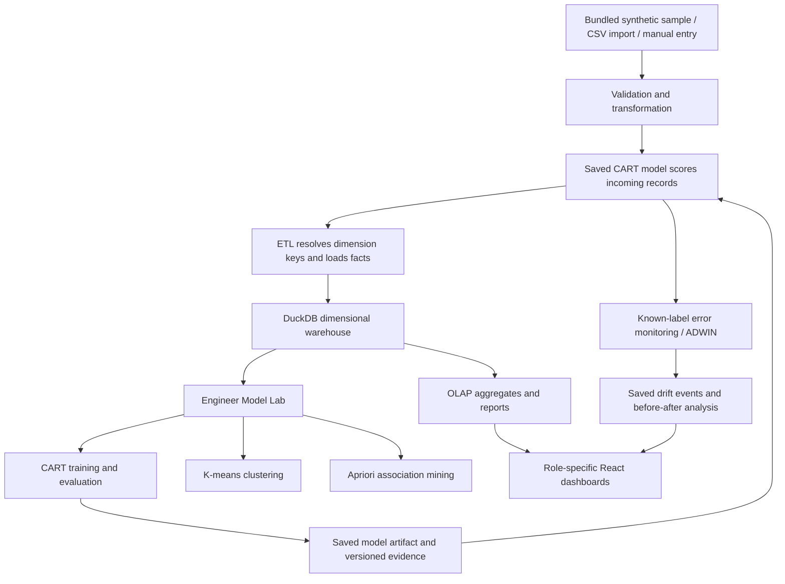
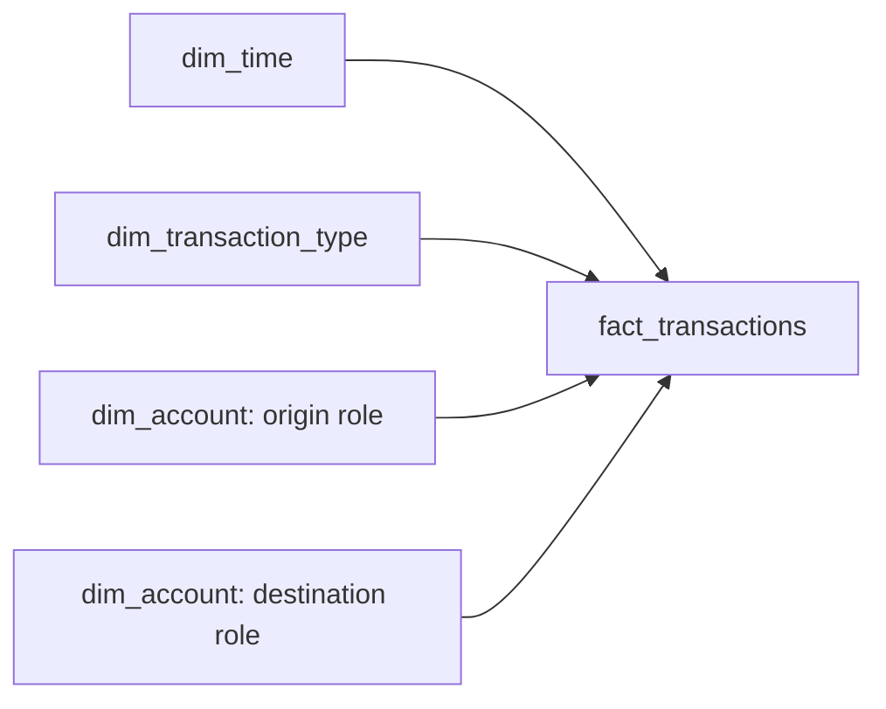
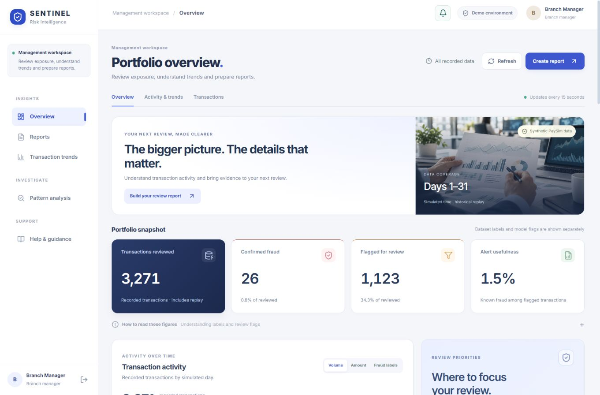

# Sentinel — Updated Project Guide for the Team and PPT

**Updated:** 5 October 2026  
**Project area:** Data Warehousing and Mining (DWM)  
**Suggested presentation title:** Sentinel: Transaction Risk Analytics Using a Dimensional Warehouse and Explainable Data Mining

This document describes the implemented project after the teacher's review and the latest dashboard and role-access updates. Use this guide and the current application when preparing the PPT. Earlier concept documents may describe features that have since changed.

## 1. Project in one sentence

Sentinel turns synthetic transaction records into a dimensional warehouse, lets users analyse them with OLAP and reports, and applies decision-tree classification, clustering and association mining to produce understandable evidence for risk review.

### Explanation in everyday language

Imagine a manager wants to know how many transactions happened, which types have known fraud, and whether the pattern changed over time. Sentinel organises the records, shows those patterns visually, and lets the manager prepare a report. An investigator reviews model flags and changes in patterns. A data engineer manages the data and demonstrates how the mining algorithms work.

The project is a local educational demonstration. It does not connect to a real bank or automatically block transactions.

## 2. Problem statement

Transaction records alone are difficult to use for risk analysis. Users need consistent summaries by time and transaction type, a way to inspect suspicious records, and explanations of the analytical results. Technical model outputs also need to be separated from everyday business workflows.

**Proposed solution:** Build a role-based transaction analytics system that integrates ETL, a dimensional warehouse, OLAP operations and explainable data mining, with visual dashboards and exportable evidence.

### Objectives

1. Store transaction ingestions at a clearly defined grain in a star schema.
2. Transform and validate source data before analytical use.
3. Support roll-up, drill-down, slice, dice and pivot on warehouse facts.
4. Translate supported business questions into scoped warehouse reports.
5. Classify transactions using a syllabus-friendly CART decision tree.
6. Discover similar transaction groups with K-means.
7. Find frequent attribute associations with Apriori.
8. Show tree structure, model evaluation and clustering visualizations.
9. Monitor changes in prediction errors and compare surrounding transaction patterns.
10. Give each role the information and controls needed for its responsibility.

## 3. What changed after the review

| Earlier approach | Current implementation |
| --- | --- |
| Hoeffding tree as the main fraud classifier | CART decision tree using scikit-learn |
| Continuous updates to the streaming model | Explicit warehouse-based training and activation |
| Streaming and drift dominated the explanation | Warehouse, ETL, OLAP and three mining tasks are central |
| Limited model evidence in the UI | Tree diagram, confusion matrix, metrics, baseline comparison and saved evidence |
| Clustering was not clearly demonstrated | K-means with PCA scatter plot, elbow plot and group summaries |
| Dataset and schema were hard to explain | Dataset dictionary, source profile, quality checks and visual star schema |
| Technical controls appeared in business workflows | Engineer-only Model Lab, imports, warehouse tools and SQL |
| Basic dashboard presentation | Redesigned navigation, images, KPI cards, charts, heatmap and responsive layout |

**Mining was not removed.** Classification, clustering and association mining are all implemented. Drift monitoring remains an additional feature. Hoeffding is no longer the active classifier. Regression is not implemented.

## 4. Dataset and its meaning

### Source

The application uses a bundled **PaySim-format synthetic mobile-money transaction sample**. It is not real customer or live bank data, and the repository does not contain the full public PaySim dataset.

The bundled CSV and the runtime warehouse are different: the CSV is source data; the warehouse can also contain replay ingestions and imported records. Their row counts should not be presented as interchangeable.

### Important fields

| Source field | Meaning |
| --- | --- |
| `step` | One simulated hour; steps 1–24 form simulation day 1 |
| `type` | PAYMENT, TRANSFER, CASH_OUT, DEBIT or CASH_IN |
| `amount` | Transaction amount in unspecified local currency units |
| `nameOrig`, `nameDest` | Synthetic source and destination account identifiers |
| Old and new balance fields | Balances before and after the transaction |
| `isFraud` | Known synthetic label: 1 for fraud, 0 for non-fraud |
| `isFlaggedFraud` | Source-system flag, distinct from the label and Sentinel's prediction |

Simulation time is not a calendar date. Do not describe amounts as rupees or dollars. Imported missing labels remain unknown rather than being treated as non-fraud.

### Terms to keep separate

| Term | Correct interpretation |
| --- | --- |
| Confirmed fraud / known fraud | A record labelled fraud in the supplied synthetic dataset |
| Flagged for review | A record predicted as fraud by Sentinel's model |
| Not flagged | The model did not flag it; this does not prove it is safe |
| Drift event | A detected change in the stream of prediction errors |
| Behaviour group | Similar transactions grouped by K-means; not a fraud verdict |

For this project, “confirmed” means the dataset label, not the outcome of an actual bank investigation.

## 5. Users and role boundaries

| Capability | Branch manager | Fraud investigator | Data engineer |
| --- | --- | --- | --- |
| Overview and risk summaries | Yes | Yes | Yes |
| Reports and transaction trends | Yes | Yes | Yes |
| Plain-language pattern analysis | Yes | Yes | Yes |
| Historical replay monitor | No | Yes | Yes |
| Dataset dictionary and star schema | No | No | Yes |
| CART, K-means and Apriori Model Lab | No | No | Yes |
| Training and activation | No | No | Yes |
| CSV import and single-record scoring | No | No | Yes |
| Warehouse health and administration | No | No | Yes |
| SQL and technical model diagnostics in the UI | No | No | Yes |
| Alert previews and simulated shift controls | No | No | Yes |

### Branch manager

Reviews exposure, trends and reports. The workspace uses business language and prioritises decisions about what to review next.

### Fraud investigator

Reviews model flags, historical replay events and changes in patterns. Pattern Analysis appears under the investigation section of this role's navigation.

### Data engineer

Explains and maintains the data pipeline, warehouse and mining experiments. This is the account to use when demonstrating DWM implementation to the teacher.

Role restrictions apply to frontend routes and protected backend endpoints. Hiding a menu is not the only access control. Authentication uses local demo accounts and expiring signed sessions; this is not a production identity system.

## 6. Architecture and data flow



Classification training reads existing warehouse facts. Ingestion scores new records with the active saved model. K-means and Apriori generate separate analytical evidence; they are not combined into the CART prediction.

### Technology stack

| Layer | Technology and purpose |
| --- | --- |
| Frontend | React and Vite for the application |
| Charts | Recharts; custom decision-tree view |
| Icons | Lucide React |
| Backend | FastAPI and Uvicorn |
| Warehouse | DuckDB |
| Data processing | pandas and NumPy |
| Classification and clustering | scikit-learn |
| Association mining | mlxtend Apriori |
| Drift monitoring | River ADWIN |
| Model persistence | joblib |
| Replay communication | WebSocket |

## 7. Data warehouse implementation

### Grain

`fact_transactions` stores **one row per transaction ingestion**. Replaying the same source sample can create new ingestions. Dashboard counts describe recorded ingestions, not necessarily unique source transactions.

Mining excludes repeated step/type/amount/balance-change/label signatures to reduce repeated observations. This is a demonstration safeguard, not a reliable substitute for real transaction identifiers.

### Star schema



Origin and destination refer to the same account dimension in two roles, rather than two separate physical account tables.

| Table | Main contents |
| --- | --- |
| `fact_transactions` | Amount, balance changes, actual label, prediction, score, error, model version and dimension keys |
| `dim_time` | Step, hour, period of day, simulation day/week and related time attributes |
| `dim_transaction_type` | Five transaction types and descriptions |
| `dim_account` | Synthetic account identifiers and descriptive attributes |
| `fact_drift_events` | Detection step, surrounding windows, error summaries and model version |
| `mining_runs` | Versioned classification, clustering and association reports with settings |
| `fact_model_evaluations` | Actual labels, predictions and scores for held-out test rows |
| `fact_cluster_assignments` | Transaction membership in a saved clustering run |
| `ingestion_runs` | Import totals, accepted and rejected records |

Not every descriptive dimension attribute is exposed as a query option. The business queries focus on time, transaction type and supported filters.

### ETL steps

1. **Extract:** read supported source records.
2. **Validate:** check values and supported transaction fields; track accepted/rejected import rows.
3. **Transform:** compute balance changes and simulation-time attributes.
4. **Score:** apply the active classifier; keep the actual label separately.
5. **Resolve dimensions:** find or create relevant time/account/type keys.
6. **Load:** save the transaction fact and associated ingestion evidence.
7. **Analyse:** aggregate warehouse facts and run mining on prepared observations.

The time dimension expands for new steps rather than assuming fixed time coverage.

## 8. OLAP: actual operations and business use

| Operation | Meaning | Example in Sentinel |
| --- | --- | --- |
| Roll-up | Combine finer records into a summary | Group hourly records into day, week or simulation-month totals |
| Drill-down | Inspect finer detail | Move from a day total to its hours |
| Slice | Keep one value of a dimension | Inspect only CASH_OUT records |
| Dice | Filter a selected subregion of dimensions | Compare TRANSFER and CASH_OUT within selected steps or periods |
| Pivot | Change the cross-tab view | Show time groups as rows and transaction types as columns |

Managers see labels such as **Summarise, More detail, One transaction type, Compare types and Cross-tab**. Engineers can inspect the OLAP names and generated SQL.

### Time conventions

- One simulation day = 24 steps.
- One simulation week = seven simulation days.
- One simulation month = 30 simulation days, not a calendar month.
- A first-month report scopes steps 1–720.
- Month and week both drill into day and then hour. Weeks do not fit exactly inside 30-day months.
- Partial data coverage is disclosed; missing records are not invented.

### Text-to-report example

> Show cash-out fraud by week for the first month.

1. The local parser recognises the supported question.
2. It selects CASH_OUT: a slice.
3. It restricts the first 30-day simulation month.
4. It groups the facts by simulation week: a roll-up.
5. DuckDB returns actual counts, amounts and known fraud totals.
6. The application displays the interpretation and exportable result.

This is a constrained local language parser, not an unrestricted chatbot. Unsupported questions receive an explanation. No external AI API key is required. SQL is visible only in the engineer workspace.

## 9. Classification: CART decision tree

### Purpose

Predict whether a transaction should be flagged for review using labelled warehouse records. This is supervised classification because the target is a category: fraud or non-fraud.

### Why CART

CART is a decision-tree algorithm, rather than a different category from a “normal decision tree.” It produces binary splits that can be explained as if–then decisions. The current implementation uses Gini or entropy as selectable split criteria.

### Features and controls

- Transaction amount.
- Origin and destination balance changes.
- One-hot encoded transaction type.
- Default maximum depth: 4.
- Default minimum samples per leaf: 5.
- Default later-step test fraction: 25%.
- Balanced class weights to address class imbalance.
- Fixed random seed for reproducibility.

Known labels, source fraud flags, account identifiers and historical predictions are excluded from classifier features. Balance changes are known after the transaction; the task is retrospective review, not pre-authorisation blocking.

### Training and evaluation

1. Read valid labelled warehouse observations.
2. Exclude repeated mining signatures.
3. Sort distinct simulation steps.
4. Train on earlier steps and test on later steps.
5. Keep all records from the same step on the same side of the split.
6. Compare against an always-non-fraud baseline.
7. Save settings, test predictions, metrics, tree structure and model version.
8. Activate and persist the fitted tree for subsequent scoring.

### What the Model Lab shows

- Interactive decision-tree diagram and text branches.
- Confusion matrix: correct non-fraud, false alarms, missed fraud and fraud found.
- Precision, recall, F1 and accuracy.
- Baseline comparison chart.
- Feature-importance chart.
- Precision–recall curve when the test labels support it.
- Training/test ranges, fraud counts, settings and warnings.
- Exportable JSON evidence and recent run history.

### Metrics in simple language

| Metric | Meaning |
| --- | --- |
| Precision | Among flagged test records, how many were actually labelled fraud? |
| Recall | Among actual fraud test records, how many did the model find? |
| F1 | A balance between precision and recall |
| Accuracy | Share of all test predictions that were correct |

Accuracy alone can be misleading when fraud is rare. Always show the test fraud count and false alarms beside percentage metrics. Scores are class-weighted leaf estimates, not calibrated banking fraud probabilities.

## 10. Clustering: K-means behaviour groups

### Purpose and method

Group transactions with similar behaviour without using fraud labels to create the groups. This is unsupervised learning.

1. Prepare transaction amount, balance changes and encoded transaction type.
2. Apply signed-log transforms to the numerical transaction features.
3. Standardise features so scale does not dominate distance.
4. Run K-means with the engineer's chosen group count (2–6; default 3).
5. Save assignments and group summaries.
6. Inspect known fraud labels after grouping.

### Visual evidence

- **PCA scatter plot:** two-dimensional display of sampled group members.
- **Elbow plot:** inertia for different numbers of groups.
- **Silhouette score:** indication of group separation.
- **Group cards:** counts, dominant transaction type, median amount and known-label totals.

PCA is a display projection, not a separate fraud model. Its axes are components, not money or risk. Up to 800 points are displayed, while clustering can use up to 20,000 deterministically sampled valid mining observations.

A group containing fraud-labelled rows is not automatically a fraudulent group. Cluster numbers are identifiers, not risk rankings.

## 11. Association mining: Apriori

### Purpose

Find combinations of discretised transaction attributes that frequently occur together. The engineer sets minimum support, confidence and lift, runs mining, and inspects the resulting rule table.

| Measure | Meaning |
| --- | --- |
| Support | Fraction of analysed records containing both sides of the rule |
| Confidence | Fraction of records matching the left side that also match the right side |
| Lift | Confidence compared with the overall frequency of the right side |

Attributes are discretised into items; frequent itemsets are limited to length three. Mining uses at most 20,000 sampled valid observations, and the Model Lab shows up to 30 qualifying rules.

Rules and their settings are saved. Empty results are valid when no rule passes the thresholds. Association indicates co-occurrence, not causation. Apriori does not retrain CART or automatically block transactions.

## 12. Drift, replay and retraining

### Replay

The Transaction Monitor sends historical synthetic records over a WebSocket. Users can start, pause, reset and change replay speed. Reset rewinds replay without deleting saved warehouse records or the fitted model.

### Drift detection

For records with a known label, the application compares the model prediction with that label. ADWIN monitors this error stream for a statistical change. A detected event is saved with its step and relevant model context.

Pattern Analysis follows the latest saved event while open, unless a user manually selects an earlier event. It compares equal-sized simulation-step windows and provides plain-language observations about counts and rates. Equal time-window lengths do not imply equal transaction counts; sparse or incomplete windows need caution.

A detected error change is evidence to investigate. It does not by itself prove the cause, a new fraud technique or that fraud necessarily increased.

### Does the model train itself every time?

**No.** The fitted CART tree stays fixed while replaying or scoring incoming records. Known labels update replay metrics and the error detector, not the tree weights.

- On startup, the application restores the saved tree when available.
- If a valid saved model is unavailable and sufficient labelled data exists, startup can train a default tree.
- Later retraining is explicitly run and activated by the engineer in Model Lab.
- Activating a new tree resets the drift detector so replacement is not interpreted as drift.
- The model and training evidence persist; the detector's internal monitoring state is in memory.

The engineer can arm a synthetic shift scenario for subsequent fraud-labelled replay records. This is a simulation control, clearly separate from a detected event. It does not guarantee a drift alert.

## 13. Notifications and synchronization

- The notification bell checks recorded data for review leads, known fraud labels and drift events.
- Overview refreshes every 15 seconds while visible.
- Pattern Analysis checks for new drift events every 10 seconds while open.
- Model Lab periodically refreshes saved evidence while visible.
- Reports and OLAP results reflect the query executed for their selected scope; rerun or refresh when data changes.
- Saved mining runs remain snapshots. They do not silently update when new warehouse rows arrive.
- Engineer alert-preview buttons display examples without scoring transactions or creating actual drift events.

Pages read the same warehouse, but they can show different scopes, windows or saved snapshots. Synchronization does not mean every page should display identical counts.

If the newest transactions all show “Not flagged,” that may be correct. The overview's “Latest flagged” option searches flagged rows across the warehouse rather than only the newest few records.

## 14. Dashboard pages and their purpose

| Page | What to demonstrate |
| --- | --- |
| Overview | Portfolio totals, label/flag distinction, daily activity, review priorities, heatmap, weekly pattern, transaction mix and searchable recent activity |
| Reports | Supported text question, interpreted scope and grouping, warehouse result and export |
| Transaction trends / Explore data | Explicit OLAP operations, time granularity, filters and cross-tab views |
| Pattern Analysis | Recorded event selection, window comparison and plain-language changes |
| Transaction Monitor | Honest historical replay, predictions beside known labels and monitoring controls |
| Dataset & warehouse | Source profile, class distribution, dictionary, sample records, star schema and ETL quality |
| Model Lab | Classification, clustering and association experiments with saved evidence |
| Warehouse health | Table counts, schema and data-quality checks |
| Import data | Engineer-only supported CSV ingestion and single-record scoring |
| Help & guidance | Role-specific tasks and business definitions; engineer view includes technical guidance |

### Latest UI changes

The application now uses a light navigation rail, blue accents, visible card boundaries, a photo briefing section, clearer typography and spacing, and distinct workspace identities. Charts and tables support actual data exploration. The manager dashboard has been checked on desktop and mobile without horizontal page overflow.

Technical detail remains available to the engineer without crowding the manager or investigator workflow.

## 15. Results: how to present them honestly

Use the application to capture the latest saved run and its settings immediately before preparing your results slide. Counts and metrics can change after imports, replay or retraining.

### Previously verified snapshot — 2 October 2026

These values are historical demonstration evidence from `AUDIT_AND_DEMO_PLAN.md`, not promises about every future run:

| Evidence | Recorded snapshot |
| --- | --- |
| Source CSV | 2,838 rows; 23 fraud labels |
| Runtime transaction facts | 3,271 ingestions |
| Distinct mining signatures | 2,841 |
| CART train/test periods | Train steps 1–558; test steps 559–744 |
| Test records | 747, including 8 fraud labels |
| Fraud found / missed | 7 / 1 |
| False alarms | 26 |
| Test precision / recall / F1 | 21.2% / 87.5% / 34.1% |
| K-means snapshot | 3 groups; silhouette approximately 0.361 |
| Apriori snapshot | 17 rules met the saved default thresholds |

The latest dashboard verification retained 3,271 facts. Overview totals contain historical predictions from different model versions; they are not the same evaluation population as the active CART's held-out test set. Never use overview alert usefulness as though it were the active model's test precision.

## 16. Implementation verification

- Latest backend suite: **16 tests passed** after the role-access update.
- Latest frontend production build: **passed**.
- Earlier frontend parser/alert checks: **9 tests passed**; these were not rerun as part of the last visual-only revision.
- Browser verification covered manager, investigator and engineer workspaces, restricted routes, business OLAP views, saved model evidence and responsive manager layout.

These checks establish that the covered local workflows work. They do not establish production bank reliability or real-world fraud-detection performance.

## 17. Limits and future scope

### Current limits

- Synthetic sample, not real bank customer data or a live financial feed.
- Small number of fraud labels; test metrics are unstable and sample-dependent.
- Regression is not implemented; the current prediction target is categorical.
- No online self-training, automatic drift-triggered retraining or learning from its own predictions.
- No transaction blocking, case assignment, investigator disposition or regulatory filing workflow.
- Local constrained text parser rather than general-purpose conversational AI.
- Repeated mining signatures are deduplicated, but genuine source transaction identity is not implemented.
- Historical predictions retain their original model version rather than being silently rescored.
- Embedded warehouse and in-memory replay are intended for a single local process.
- Demo authentication is not an organisation identity provider.
- Exact syllabus alignment still needs the teacher's syllabus or rubric.

### Future work — proposals, not current features

1. Integrate a suitably licensed anonymised transaction dataset or an authorised bank feed.
2. Introduce stable source transaction IDs and ingestion deduplication.
3. Validate performance on an untouched independent dataset.
4. Add investigator feedback and controlled retraining approvals.
5. Improve model calibration and threshold selection using independent evidence.
6. Add organisation authentication, audit logging and production ingestion infrastructure.
7. Add a regression task only if there is a meaningful continuous target, such as a well-defined amount forecast.

## 18. Suggested PPT structure

| Slide | Title | Content / screenshot |
| --- | --- | --- |
| 1 | Title and team | Sentinel, DWM project, team members |
| 2 | Problem statement | Need for organised, explainable transaction analytics |
| 3 | Objectives and scope | Warehouse + OLAP + three mining tasks; synthetic demonstration |
| 4 | Dataset | Source, one sample record, field meanings and class imbalance |
| 5 | Users | Three roles and their responsibilities |
| 6 | Architecture | Data-flow diagram from Section 6 |
| 7 | ETL and star schema | Grain, facts, dimensions and quality handling |
| 8 | OLAP implementation | Five operations with application screenshots |
| 9 | Text-to-report | Example question, interpretation and result |
| 10 | CART classification | Features, settings and chronological split |
| 11 | Classification results | Tree, confusion matrix, baseline and test metrics |
| 12 | K-means clustering | PCA plot, elbow plot and group interpretation |
| 13 | Apriori associations | Actual saved rules and support/confidence/lift |
| 14 | Drift and replay | Error monitoring, before/after analysis and explicit retraining |
| 15 | Role-specific dashboards | Manager view and engineer Model Lab |
| 16 | Verification and limits | Tests, synthetic source and performance boundaries |
| 17 | Conclusion and future scope | What was implemented and meaningful next steps |

Use screenshots from the actual application, with the role and saved-run context visible. Do not use invented model graphs. If slides are limited, combine slides 5–6, 10–11 and 16–17.

## 19. Recommended live demonstration

1. **Engineer sign-in:** Dataset & warehouse → source dictionary → star schema → data quality.
2. **OLAP:** summarise by week, drill into a day, slice CASH_OUT, dice selected types/time, then pivot.
3. **Model Lab:** show CART settings, saved chronological split, tree and confusion matrix. Retrain only if you want to create a new active run.
4. **Behaviour groups:** show or run K-means, explain the PCA plot and group summaries.
5. **Association rules:** show actual Apriori results and explain one rule's measures.
6. **Manager sign-in:** show the redesigned overview and create a supported business report.
7. **Investigator sign-in:** show Pattern Analysis and historical replay monitoring.
8. **Engineer alert preview, if needed:** demonstrate notification appearance; explicitly call it a preview.

A real drift event may not occur during a short demo. Use a previously recorded event for explanation instead of claiming a guaranteed detection.

## 20. Short presentation script

> Our project is Sentinel, a DWM-based transaction risk analytics demonstration. We use a synthetic PaySim-format sample rather than a live bank feed. We transform the records into a dimensional warehouse and support roll-up, drill-down, slice, dice and pivot. Our mining module uses CART for classification, K-means for behaviour groups and Apriori for associations. We show the actual model evidence through a decision-tree diagram, confusion matrix and clustering plots. Managers see risk summaries and reports, investigators review flags and changes, and engineers manage the data and models. The saved tree scores replay records; retraining is explicit. The results support explanation and review, not production fraud blocking.

## 21. Viva questions and answers

**Where is DWM integrated?**  
ETL loads a star-schema warehouse; OLAP queries aggregate its facts; classification, clustering and association mining read prepared warehouse observations and save their evidence.

**Why use a warehouse instead of only a CSV?**  
It provides consistent dimension joins, a defined analytical grain, reusable summaries and persisted ingestion/mining evidence. The project demonstrates these functions locally in DuckDB.

**Why did you replace Hoeffding?**  
To make the classifier easier to demonstrate against common decision-tree teaching concepts, with controlled training and visible tree/evaluation evidence. Hoeffding is not the active model.

**Is CART a decision tree?**  
Yes. CART is an algorithm for constructing decision trees; the implementation here performs classification with binary splits.

**Why no regression?**  
The current target is fraud/non-fraud, a category. Regression would require a meaningful continuous target and a separate evaluation design.

**Is the data real or live?**  
No. It is synthetic transaction data replayed locally. The dashboard labels this explicitly.

**Does every transaction retrain the model?**  
No. Incoming transactions use the saved tree. The engineer explicitly retrains from labelled warehouse observations.

**What does drift mean here?**  
A statistical change in prediction errors. The application compares surrounding transaction windows to help interpret it; it does not automatically establish a cause.

**Are clusters fraud categories?**  
No. They group similar features without labels. Known fraud labels are inspected afterwards.

**Do association rules prove fraud?**  
No. They describe co-occurrence under chosen thresholds.

**Why do dashboard and model metrics differ?**  
The overview summarises recorded ingestions and historical model versions. Model Lab evaluates one saved model on a specific later-step test window.

**Does this need an AI API key?**  
No. Models, reports and explanations run locally.

## 22. Running the project

Requirements: Python 3.10+ and Node.js 18+.

Backend terminal:

```powershell
cd backend
python -m pip install -r requirements.txt
python -m uvicorn app.main:app --reload --port 8000
```

Frontend terminal:

```powershell
cd frontend
npm install
npm run dev
```

Open <http://localhost:5173>. The frontend proxies backend API and WebSocket requests. The local writable warehouse normally lives at `backend/data/sentinel_runtime.duckdb`; `SENTINEL_WAREHOUSE_PATH` can select another file.

### Local demo accounts

| Role | Email | Password |
| --- | --- | --- |
| Branch manager | `manager@sentinel.demo` | `SentinelDemo!2026` |
| Fraud investigator | `investigator@sentinel.demo` | `SentinelDemo!2026` |
| Data engineer | `engineer@sentinel.demo` | `SentinelDemo!2026` |

These are local demonstration credentials. Tokens expire after eight hours. A server restart can invalidate sessions unless a persistent session secret is configured. Environment settings can change or disable the demo accounts. For the PPT, show role names rather than passwords.

### Verification commands

```powershell
# From backend
python -m unittest discover -s tests -v

# From frontend
node --test src/lib/*.test.js
npm run build
```

## 23. Code and screenshot map for the team

| Location | What it explains |
| --- | --- |
| `backend/app/warehouse/ddl.py` | Warehouse schema |
| `backend/app/warehouse/etl.py` | Fact and dimension loading |
| `backend/app/warehouse/olap_queries.py` | OLAP queries |
| `backend/app/intelligence/model_lab.py` | CART evaluation, persistence and K-means |
| `backend/app/intelligence/rule_miner.py` | Apriori and association comparison |
| `backend/app/intelligence/drift_detector.py` | ADWIN error monitoring |
| `backend/app/routes/learning.py` | Dataset and mining endpoints |
| `backend/app/auth.py` | Demo authentication |
| `frontend/src/context/RoleContext.jsx` | Role-specific route configuration |
| `frontend/src/pages/ModelLab.jsx` | Mining visualizations |
| `frontend/src/pages/CommandCenter.jsx` | Overview dashboard |
| `frontend/src/pages/ReportBuilder.jsx` | Question-based reports |
| `docs/WORKSPACE_ROLES.md` | Current access matrix and design references |
| `docs/screenshots/manager-workspace.png` | Latest redesigned manager dashboard |



## 24. References and further reading

- [PaySim project](https://github.com/EdgarLopezPhD/PaySim)
- [scikit-learn decision trees](https://scikit-learn.org/stable/modules/tree.html)
- [scikit-learn clustering](https://scikit-learn.org/stable/modules/clustering.html)
- [mlxtend Apriori](https://rasbt.github.io/mlxtend/user_guide/frequent_patterns/apriori/)
- [River ADWIN](https://riverml.xyz/latest/api/drift/ADWIN/)
- [Kimball dimensional modelling techniques](https://www.kimballgroup.com/data-warehouse-business-intelligence-resources/kimball-techniques/dimensional-modeling-techniques/)
- [DuckDB documentation](https://duckdb.org/docs/)
- UI references: [Finance Analytics Dashboard](https://dribbble.com/shots/25765497-Finance-Analytics-Dashboard), [NeuroBank Dashboard](https://dribbble.com/shots/26127078-NeuroBank-Online-Banking-Dashboard-Design). These informed the design; their assets were not reused.

## 25. Conclusion

Sentinel demonstrates an integrated DWM workflow: source records become validated dimensional facts, OLAP provides useful business summaries, and explainable mining produces saved classification, clustering and association evidence. Role-specific dashboards make the results accessible without exposing technical controls to business users. Its value is the traceable analytical workflow and honest explanation of results; the synthetic sample does not establish production banking performance.
